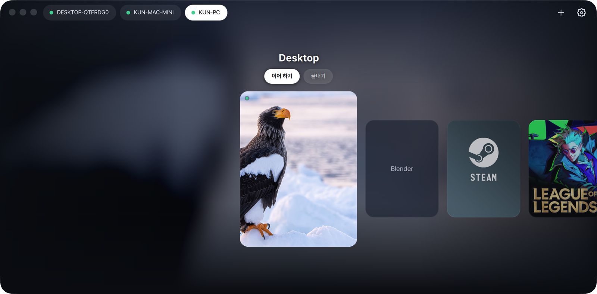

# KUNLIGHT (Mac)

[Moonlight PC](https://github.com/moonlight-stream/moonlight-qt)를 고쳐 쓰는 개인 빌드입니다. [Sunshine](https://github.com/LizardByte/Sunshine)이 켜진 PC의 화면을 맥으로 스트리밍합니다. 아이폰·아이패드판은 [kunlight-ios](https://github.com/Kun-9/kunlight-ios)에 있습니다.

## 바뀐 점

- 콘솔식 홈: 위 줄에 PC 칩, 가운데 큰 표지, 고른 게임의 흐린 배경. 표지는 창 크기에 맞춰 커집니다.
- PC 칩과 게임은 꾹 눌러 끌면 순서가 바뀌고, 바꾼 순서는 저장됩니다.
- 실행 중인 게임은 표지에 초록 점, 위에 "이어 하기"·"끝내기" 버튼.
- 둥근 큰 표지의 접속 중 화면.
- 통계를 카드나 한 줄 띠로 표시. 단축키(⌃⌥⇧ + 글자)는 설정에서 바꿉니다.
- 한영 키: 설정에서 고른 키가 PC에 한/영 전환(VK_HANGUL)을 보냅니다.
- 한국어 화면, Pretendard 글꼴, 제목 막대 없는 창.

## 빌드

원본 Moonlight와 같습니다. [README.moonlight.md](README.moonlight.md)의 빌드 방법을 따르고, 맥(Homebrew Qt 6): `git submodule update --init --recursive`, 그다음 `mkdir build && cd build && qmake6 ../moonlight-qt.pro CONFIG+=release && make`. 결과는 `build/app/Moonlight.app`.

윈도우·리눅스에서도 같은 코드로 빌드할 수 있게 두었지만, 빌드해 보지는 않았습니다.

## 라이선스

원본과 같은 GPLv3입니다. 글꼴 Pretendard 는 SIL Open Font License(`app/res/fonts/Pretendard-LICENSE.txt`)를 따릅니다.
